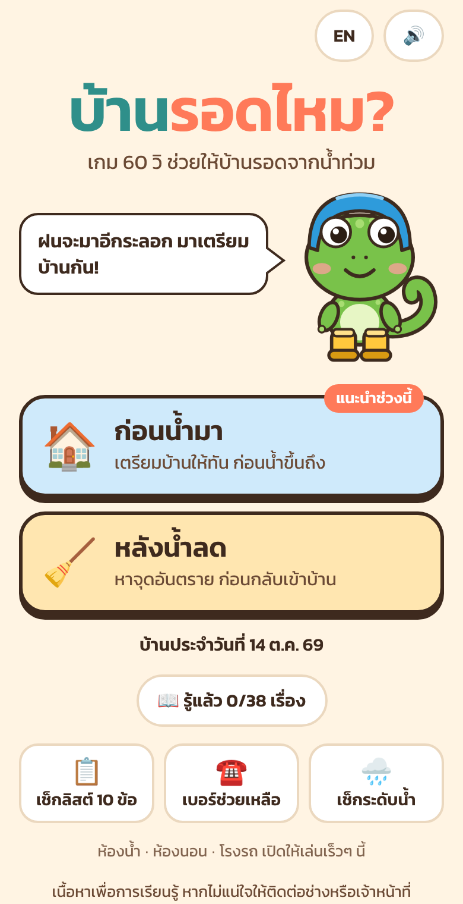

# บ้านรอดไหม? (Baan Rod Mai?)

**A 60-second hazard-hunt game that teaches Thai families how to protect their home through the year (floods, PM2.5 dust and house fire), and is built to be forwarded.** Play it in Thai at **[baanrodmai.autobahn.bot](https://baanrodmai.autobahn.bot)** or in English at **[baanrodmai.autobahn.bot/en/](https://baanrodmai.autobahn.bot/en/)**.

- **ก่อนน้ำมา (Before the flood):** get the house ready before the water rises.
- **หลังน้ำลด (After the water drops):** spot the dangers before moving back in.
- **ฝุ่น PM2.5 (PM2.5 dust, v1.5.0):** shut out the dust and look after the people most at risk.
- **ไฟไหม้ (House fire, v1.5.0):** find the fire risks, and know how to get out of smoke.

The start screen recommends the mode in season: dust in December–March, fire in April, floods from May. A post can also link straight to one mode (`/?mode=dust`) or to a hazard's own page (`/pm25`).

Every tap teaches one real action from a Thai agency (ปภ., กฟน., กฟภ., กรมควบคุมโรค, กรมอนามัย…), cross-checked with WHO or the US Fire Administration where they cover the same ground. Every result becomes a card for the family LINE group.

<p>



</p>

> **Status (18 Oct 2026): v1.6.1, live at [https://baanrodmai.autobahn.bot](https://baanrodmai.autobahn.bot), not yet launched.**
>
> - The code is finished and every automated check passes: 23 rule tests and 81 headless-browser checks, plus CI on every push.
> - **Thai and English**, each with its own pages, link previews and search signals ([international version](#thai-and-english)).
> - The water-level button opens **BKK FloodWatch** (`flood.autobahn.bot`), the owner's own Autobahn Bot project.
> - Before launch it still needs Web Analytics switched on, the sitemap and the six new hazard pages submitted to the search consoles, a review of 11 safety items flagged ⚠️ and of the dust and fire lessons, a native-speaker language check, and a pass on real phones.
> - Start with **[HANDOFF.md](HANDOFF.md)**.

## Highlights

- **Plain HTML, CSS and JavaScript with SVG art.** No framework and no build dependencies. It runs on the **free Cloudflare Pages plan**.
- **Thai and English.** Thai at `/`, English at `/en/`; the first visit picks Thai for Thai browsers or Bangkok time and English for everyone else.
- **Light:** 188 KB compressed to the start screen and 201 KB to the first game screen (the limit is 500 KB).
- **Findable by search engines and AI assistants, in both languages.** The game draws itself with JavaScript, so the build also writes plain-HTML pages and files that crawlers can read ([details below](#seo-and-ai-search)).
- **Made to be shared and replayed (v1.3.0).** The result card prints the link to its own house, a friend's challenge can be answered with both scores, a safety book collects the playable lessons by topic (66 in 8 topics today), and a perfect 10 gets its own stamp.
- **Knowledge by topic (v1.4.0).** Every lesson has a topic: 🦠 health after floods, ⚡ power & gas, 💧 water & food, 🐍 snakes & sharp things, 🏠 home, 🎒 plans, and since v1.5.0 😷 dust and smoke and 🔥 fire safety. The topic in the news gets a card on the start screen, and `/learn#t-health` links straight to it.
- **A game for the whole year (v1.5.0).** Four modes on one mode registry: flood before and after, PM2.5 dust (a thickening haze, the Air4Thai colours, an Air4Thai link) and house fire (smoke falling from the ceiling, helpline 199). 66 playable lessons in 8 topics, each mode with its own challenge links, previews and 10-item checklist.
- **Keeps itself current, links straight to a mode, a page per hazard (v1.6.0).** The owner's switches (the rain warning, the topic in the news) have end dates and turn themselves off, so the start screen can't stay on floods into the dust season. `/?mode=dust` opens the game on one mode for posts and campaigns. `/flood`, `/pm25` and `/fire` (and `/en/…`) each show one hazard's lessons, checklists and helplines, with a ▶ button into the game and a link preview of their own. The shared result card now carries the ending that answers "บ้านรอดไหม?".
- **Posts that teach on their own (v1.6.1).** Each hazard has a ready-made set of images for a Facebook album, an Instagram carousel or LINE: a cover, one page per lesson with its source, the checklists and the game's address. Open [`/posts`](https://baanrodmai.autobahn.bot/posts) on a phone to save them in order and copy the Thai caption ([04-launch-kit](docs/04-launch-kit.md#posting-the-carousels-v161)).
- **Plays offline after the first visit,** thanks to a service worker.
- **Works inside the LINE, Facebook and TikTok in-app browsers.** Where an app blocks sharing or downloads, the game falls back to another way.
- **All content is editable JSON** in `public/content/`. The build checks it before anything is published.
- **No personal data and no cookies.** Only anonymous event counts are collected.
- **Accessible:**
  - every tap target and button is at least 44 px on phones 360 px wide or wider
  - highlights are colour-blind safe (blue / orange / grey, plus shapes)
  - nothing flashes
  - it respects reduced-motion settings

## Quick start

```bash
node tools/build.mjs                    # validate content, generate preview pages and the service worker
npx wrangler@latest pages dev public    # http://localhost:8788
npm test                                # game-rule tests (no browser)
npm install && npm run smoke            # browser checks (needs Chromium; set CHROME_PATH if needed)
npm run check:docs                      # after editing docs: every relative link and anchor resolves
```

Node 18 or later is required. Cloudflare builds with Node 22, pinned in `.node-version`. Browser checks use `playwright-core` 1.63.0. Install its browser with `npx playwright@1.63.0 install chromium`, or point `CHROME_PATH` at any recent Chromium.

## Thai and English

| | Thai | English |
|---|---|---|
| The game | `/` | `/en/` |
| Every lesson, with sources | `/learn` | `/en/learn` |
| A friend's challenge link | `/c/p8?h=…` | `/en/c/p8?h=…` |
| Family checklists | `/checklist/prepare` | `/en/checklist/prepare` |
| One hazard's lessons (v1.6.0) | `/flood`, `/pm25`, `/fire` | `/en/flood`, `/en/pm25`, `/en/fire` |
| Open the game on one mode (v1.6.0) | `/?mode=dust` | `/en/?mode=dust` |
| Wordmark | บ้านรอดไหม? | Baan Rod Mai? |

- **Which language a visitor gets:** `?lang=`, then an `/en` address, then their earlier choice, then a first-visit guess (Thai for Thai browsers **or** Bangkok time, English otherwise). The address bar follows the language, and English players share `/en/` links.
- **Search and social:** each page and its other-language twin point to each other with `hreflang`; the sitemap lists both; each language has its own link previews (`public/og/` and `public/og/en/`) and its own structured data.
- **Honest scope outside Thailand:** the advice comes from Thai agencies and the helplines are Thai numbers, and the English pages say so. Details: [KNOWLEDGE §18](docs/KNOWLEDGE.md#18-international-version-and-social-previews).

## SEO and AI search

Most AI crawlers and link-preview bots don't run JavaScript, so a game that renders in the browser looks empty to them. `node tools/build.mjs` therefore also writes, from the same JSON the game uses:

| Output | For |
|---|---|
| [`/learn`](https://baanrodmai.autobahn.bot/learn) and [`/en/learn`](https://baanrodmai.autobahn.bot/en/learn) | Every lesson (correct action, tip, reason, sources, ⚠️ where partly verified), every checklist and the helplines: Thai with English, and English-first. Plain HTML, no script. |
| [`/flood`](https://baanrodmai.autobahn.bot/flood), [`/pm25`](https://baanrodmai.autobahn.bot/pm25), [`/fire`](https://baanrodmai.autobahn.bot/fire) and their `/en/` twins (v1.6.0) | One hazard each: its lessons, checklists and helplines, with ▶ buttons that open the game on that mode. Plain HTML, no script. The addresses come from `config.json → hazards` and never change once published. |
| `/llms.txt` | A Markdown summary for AI assistants ([llmstxt.org](https://llmstxt.org)), listing both languages |
| `/sitemap.xml`, `/robots.txt` | Crawler discovery (10 addresses), with `hreflang` pairs. Search and AI crawlers are welcome; only `/api/` is closed. |
| `<link rel="canonical">`, `hreflang` and JSON-LD | `WebSite` + `VideoGame` on `/` and `/en/`, and `Article` with source citations on `/learn`, the hazard pages and their English twins. The share-preview pages point their canonical at `/` (Thai) or `/en/` (English). |
| `X-Robots-Tag: noindex` on `*.pages.dev` | Only the custom domain is indexed |

The Thai and English copy for these pages is in `public/content/strings.json → seo` (and `ogEn` for English link previews). Bump `seo.updated` when lessons change. The rules and the reasons are in [APPROACH_AND_METHOD §13](docs/APPROACH_AND_METHOD.md#13-making-the-game-findable-seo-and-ai-search).

## Deploy (Cloudflare Pages, about 5 minutes)

The live site was set up this way on 6 Oct 2026: project `baanrodmai`, address https://baanrodmai.autobahn.bot. The setup is recorded in [docs/03-deploy.md](docs/03-deploy.md#the-live-setup). To repeat it elsewhere, connect this repository under **Workers & Pages → Create → Pages → Connect to Git** and use these settings:

| Setting | Value |
|---|---|
| Framework preset | None |
| Root directory | *(leave empty: the repository root)* |
| Build command | `node tools/build.mjs` |
| Build output directory | `public` |
| Site address | `config.json → siteUrl`. Because `wrangler.toml` manages the project, a dashboard `SITE_URL` is cleared on the next build. |

You also need **Analytics Engine** enabled once on the Cloudflare account (Workers → Analytics Engine → create the dataset `baanrodmai_events` with binding `EVENTS`). Without it the deploy fails at the Functions step. The full steps are in [docs/03-deploy.md](docs/03-deploy.md). They cover Wrangler direct upload, Web Analytics, the Analytics Engine binding, "Fail open", and baking your domain into the images.

## Documents

**Start here**

| Document | What's inside |
|---|---|
| [HANDOFF.md](HANDOFF.md) | Current state, what the owner must decide before launch, how to run and operate it, and next steps |
| [docs/ROADMAP.md](docs/ROADMAP.md) | What to do next: launch tasks and v1.1+ work as task cards with steps and "done when" |
| [AGENTS.md](AGENTS.md) | For AI assistants: read order, commands, definition of done, how the owner works, sandbox notes. Claude Code loads it through [CLAUDE.md](CLAUDE.md). |
| [CHANGELOG.md](CHANGELOG.md) | What changed, release by release |

**Project deliverables**

| # | Document | What's inside |
|---|---|---|
| 1 | [Safety content table](docs/01-safety-content.md) | 68 items in four modes, each with the wrong action, the correct action, a Thai tip (≤ 80 characters) and its official source. Anything not fully verified is flagged. The counts at the top are generated from the content. |
| 2 | [Game design and wireframes](docs/02-game-design.md) | Rules, the four modes, scoring, mascot, sharing, accessibility, the version 2 structure, and a code map |
| 3 | [Deploy to Cloudflare Pages](docs/03-deploy.md) | The live setup, Git and Wrangler steps, the free-plan budget, search setup, and why link previews are pre-rendered |
| 4 | [Launch kit](docs/04-launch-kit.md) | Thai post copy (Facebook, LINE, TikTok), outreach, the Prepare → Return switch, and the seasonal relaunch |
| 5 | [Metrics plan](docs/05-metrics.md) | Event dictionary and Analytics Engine SQL for every metric |
| 6 | [Test checklist](docs/06-test-checklist.md) | Automated tests, plus a real-phone matrix (43 checks across 8 browser and app combinations) and the live-site checks |

**Reference for maintainers**

| Document | What's inside |
|---|---|
| [Knowledge base](docs/KNOWLEDGE.md) | Every rule, constant and formula; the content model; platform limits; audience research with sources |
| [Known issues](docs/KNOWN_ISSUES.md) | Open issues, platform limits and deliberate trade-offs, with measurements |
| [Guidelines](docs/GUIDELINES.md) | Rules for editing safety content, writing Thai and English copy, changing code, testing and releasing |
| [Approach and method](docs/APPROACH_AND_METHOD.md) | How the project was researched, designed, built, verified, optimized, made international and kept honest |
| [Lessons learned](docs/LESSONS_LEARNED.md) | What went wrong or right while building it, and the rule each lesson became |
| [UI/UX Review & Optimization](review/README.md) | Live evaluation, 3-loop refinement cycle (9.74/10 optimal), persona validation, and [iteration log](review/ITERATION_LOG.md) |

## แก้เนื้อหาเอง (สำหรับทีมที่ไม่ได้เขียนโค้ด)

ทุกอย่างที่ผู้เล่นเห็นอยู่ในโฟลเดอร์ `public/content/` (มีทั้งภาษาไทยและอังกฤษ ต้องแก้ให้ตรงกันทั้งสองภาษา) แก้บน GitHub ได้เลย (กดรูปดินสอ → Commit) ระบบจะตรวจไฟล์ให้ก่อนขึ้นเว็บ ถ้ามีอะไรผิด เว็บเดิมจะยังอยู่ ไม่พัง

| อยากแก้อะไร | ไฟล์ | ระวัง |
|---|---|---|
| เปลี่ยนโหมดที่แนะนำ (ฝนกำลังมา / น้ำลดแล้ว) | `config.json` → `"rainWarningActive": true` หรือ `false` | เปิดเมื่อไร ใส่วันสิ้นสุดด้วยทุกครั้ง เช่น `"rainWarningUntil": "2026-11-30"` (ปี ค.ศ.-เดือน-วัน เวลาไทย นับวันนั้นด้วย หลังจากนั้นปิดเอง) |
| หมวดที่กำลังเป็นข่าวบนหน้าแรก | `config.json` → `featuredTopic` (`null` = ไม่มี) | ใส่วันสิ้นสุด `featuredTopicUntil` ด้วยทุกครั้ง |
| ลิงก์แอปเช็กระดับน้ำ / โดเมน | `config.json` → `forecastAppUrl`, `siteUrl` | ต้องขึ้นต้นด้วย `https://` |
| คำแนะนำ ตัวเลือก เคล็ดลับ คำอธิบาย "ทำไม?" | `items.json` | `tip` ไม่เกิน 80 ตัวอักษร · ต้องมีคำตอบถูก (`"correct": true`) ข้อเดียว |
| ที่มาของข้อมูล | `sources.json` | รหัสต้องตรงกับที่ใช้ใน `items.json` |
| ข้อความปุ่ม คำพูดน้องจก ฉายา ข้อความแชร์ | `strings.json` | อย่าลบ `{คำในวงเล็บปีกกา}` · แก้ทั้ง `th` และ `en` · ข้อความตัวอย่างลิงก์ภาษาอังกฤษอยู่ที่ `ogEn` |
| เช็กลิสต์ 10 ข้อ | `checklists.json` | ต้องมี 10 ข้อพอดี · ถ้าแก้แล้ว รันภาพใหม่ด้วย `npm run images` |
| เบอร์ช่วยเหลือ | `helplines.json` | ตรวจเบอร์กับหน่วยงานก่อนทุกครั้ง |
| เปิดห้องใหม่ | `rooms.json` → `"enabled": true` | ต้องมีภาพห้องใน `public/art/rooms/` ก่อน |
| ชื่อหน้าของแต่ละภัย (/flood /pm25 /fire) | `config.json` → `hazards` | ห้ามเปลี่ยนหลังเปิดตัว เพราะลิงก์ที่แชร์ไปแล้วจะเสีย |

ถ้าแก้คำแนะนำด้านความปลอดภัย ให้ใส่แหล่งที่มาใน `sources.json` ทุกครั้ง และโพสต์บอกผู้เล่นด้วยคำว่า **"UPDATE:"** อย่าแก้เงียบๆ (ดูกติกาเต็มใน [docs/GUIDELINES.md](docs/GUIDELINES.md))

## Project structure

```
public/            static site (Cloudflare Pages output directory)
  content/         ← editable JSON (items, rooms, strings, config, sources, checklists, helplines)
  js/              game modules (plain ES modules, no bundler)
  art/             room SVGs + sprite sheet
  fonts/           Kanit Thai/Latin subsets (SIL OFL, see fonts/OFL-Kanit.txt)
  og/ og/en/ share/ pre-rendered link previews (Thai, English), checklists, sample cards
  c/ checklist/    generated link-preview pages (Thai)
  flood.html pm25.html fire.html   generated hazard pages (Thai)
  en/              generated English app shell, lessons, hazard and link-preview pages
functions/api/e.js anonymous event counter → Workers Analytics Engine
tools/             build.mjs (validate + generate), render-images.mjs, sw.template.js, probe.mjs, check-docs.mjs
tests/             run.mjs (rules), smoke.mjs (headless browser)
docs/              everything above + screens/
AGENTS.md CLAUDE.md  guidance for AI assistants
```

## History

The game was first built on a feature branch of `bejranonda/carrier-vector-1988`, in its `baanrodmai/` folder. On 6 Oct 2026 it moved here, to the repository root, with its first two commits kept. That branch was never merged, and it has since been reset to `master`, so `carrier-vector-1988` holds only the flight sim again.

## Credits and license

- **Game, illustrations and the mascot น้องจก:** original work for this project. **License:** MIT, see [LICENSE](LICENSE).
- **Font:** [Kanit](https://github.com/cadsondemak/kanit) by Cadson Demak, SIL Open Font License 1.1 ([public/fonts/OFL-Kanit.txt](public/fonts/OFL-Kanit.txt)).
- **Safety guidance:** Thai government agencies, cited item by item in [docs/01-safety-content.md](docs/01-safety-content.md). The guidance itself belongs to those agencies; the game only links to and summarises it.

*เนื้อหาเพื่อการเรียนรู้ หากไม่แน่ใจให้ติดต่อช่างหรือเจ้าหน้าที่*
