# บ้านรอดไหม? (Baan Rod Mai?)

**A Thai home-preparedness app for any disaster: what to do when something happens, what to keep at home, a family plan and calculators that work out what to do from your answers, with a 60-second hazard-hunt game as the optional, easier way to remember. Built to be forwarded.** Use it in Thai at **[baanrodmai.autobahn.bot](https://baanrodmai.autobahn.bot)** or in English at **[baanrodmai.autobahn.bot/en/](https://baanrodmai.autobahn.bot/en/)**.

**Tools first (v1.9.0).** Nobody knows which hazard comes next, so the start screen opens on three tools: **📋 ต้องทำอะไร เมื่อเกิดภัย** (what to do: a short sourced guide for each of nine situations, a flood coming, after a flood, flash floods and landslides, storms and lightning, earthquakes, house fire, power cuts, extreme heat and PM2.5 dust), **🎒 เช็กของจำเป็น** (what to keep, sized for the household) and **📝 แผนครอบครัว** (the family plan card). The owner can put one guide on top while it is in the news, every guide is a picture to forward and a page to print, and nobody has to play the game to get the advice.

**You answer, it works out what to do (v1.10.0).** Two calculators sit beside them on the start screen: **🥛 ไฟดับ: ตู้เย็น** (`/fridge`: one tap for how long the power has been off, or the clock time it went off → since v1.11.0, **food by food**, what in the fridge will have to go after 4 hours and what keeps, and pack by pack what to do with the freezer; insulin keeps 28 days at 15–30 °C and other cold medicine says "check the label, ask a pharmacist", never "throw it out"; breast milk has its own cards; it keeps counting after the app is closed and keeps the answer when the power comes back; the times and lists are the US agencies' and are marked ⚠️) and **🌫️ ฝุ่นวันนี้** (`/air`: the colour an app shows, or a PM2.5 reading or Thailand's AQI → what everyone at home should do and, always, what young children, older people, pregnant women and people with a long-term illness should do as well, by the Pollution Control Department's 2023 bands, in everyday words). Inside the home check, **ยาพอกี่วัน?** works out how many days the pills last. Each uses only numbers from its sources, decides each answer on the exact figure so it never looks safer, asks one question at a time (v1.10.1), and keeps what people type on the phone.

**A tool for each moment (v1.12.0–v1.13.0).** **🧰 เครื่องมือทั้งหมด** (`/tools`) puts every tool on one page, with DDPM's steps to turn on emergency alerts and 13 Thai agencies' own pages (LINE ALERT, the TMD's warnings, ThaiWater, GISTDA, Air4Thai, MEA's and PEA's planned cuts, DDPM's 1784 LINE…). Beside the fridge and dust today: **😷 ใส่หน้ากากไหม แบบไหน?** (`/mask`: when and which mask for dust, a clean-up, illness or smoke, and that a fire at home means getting out, not a mask), **🌡️ ร้อนวันนี้** (`/hot`: the heat level announced today → what everyone and the people at risk do, heatstroke signs and first aid), **💧 น้ำพอกี่วัน** (`/water`), **🚰 ล้างถังพักน้ำ** (`/tank`: how much chlorine for the tank), **🆔 บัตรข้อมูลฉุกเฉิน** (`/info`: medicines, allergies and contacts as a picture on the phone), **💬 ส่งข่าวว่าปลอดภัย** (`/safe`: one message to the family by LINE or SMS) and **🧳 กระเป๋าฉุกเฉิน** (`/bag`: what to grab, with rows for a baby, an older person and a pet). Two tiles on the start screen change with the season.

The game has five modes:

- **ก่อนน้ำมา (Before the flood):** get the house ready before the water rises.
- **หลังน้ำลด (After the water drops):** spot the dangers before moving back in.
- **ฝุ่น PM2.5 (PM2.5 dust, v1.5.0):** shut out the dust and look after the people most at risk.
- **ไฟไหม้ (House fire, v1.5.0):** find the fire risks, and know how to get out of smoke.
- **ไฟดับ (Power cut, v1.7.0):** stock up and get through a night without power: keep the fridge shut, torches, not candles. Any time of year.

The start screen recommends the mode in season: dust in December–March, fire in April, floods from May. The power cut is never the default; it is always one tap away. A post can also link straight to one mode (`/?mode=dust`, `/?mode=stock`) or to a hazard's own page (`/pm25`, `/ready`).

Outside the round, two tools for the family at home (v1.8.0): **เช็กของจำเป็น** ("บ้านเราพร้อมแค่ไหน?", `/kit`) works out what this household needs for a flood, a power cut or 3 days indoors and how ready it is, and **แผนครอบครัว** (`/plan`) makes a card with the family's meeting place, contact and who helps whom, to keep on every phone. What people answer and type stays on their phone. Since v1.8.1 the check is offered on the flood results as well as the power cut's, both tools are linked from `/flood` and `/learn` as well as `/ready`, and a long-press on the installed app's icon opens either.

Every tap teaches one real action with its source. Most come from Thai agencies (ปภ., กฟน., กฟภ., กรมควบคุมโรค, กรมอนามัย…), cross-checked with WHO or the US Fire Administration where they cover the same ground. Where only a foreign agency gives the advice (the smoke alarm; most power-cut lessons, from the US CDC and Ready.gov), the lesson is marked ⚠️ and says so. Every result becomes a card for the family LINE group.

<p>
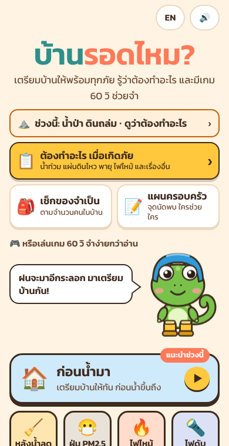
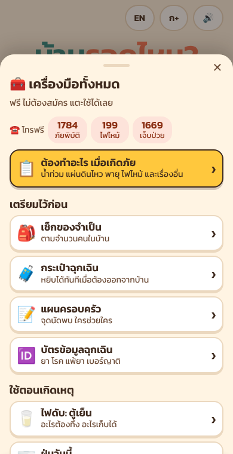
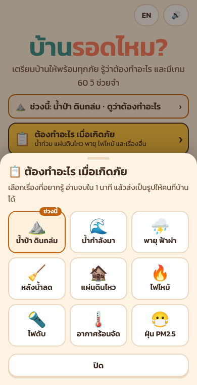
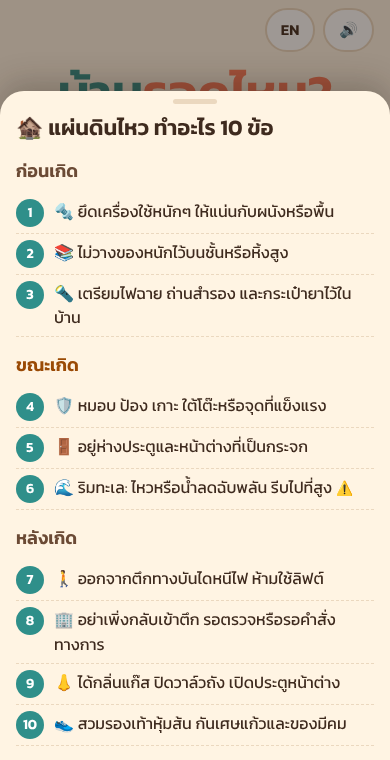
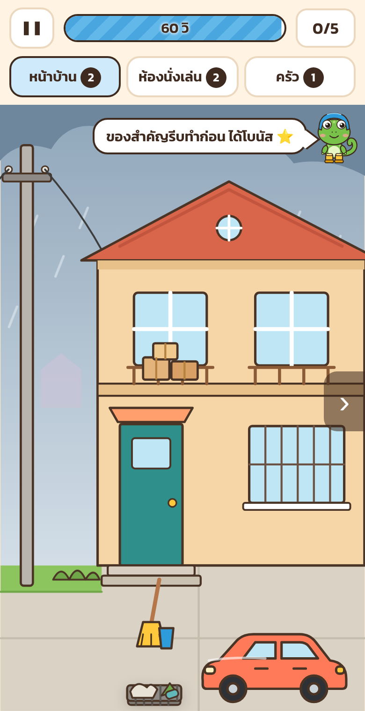
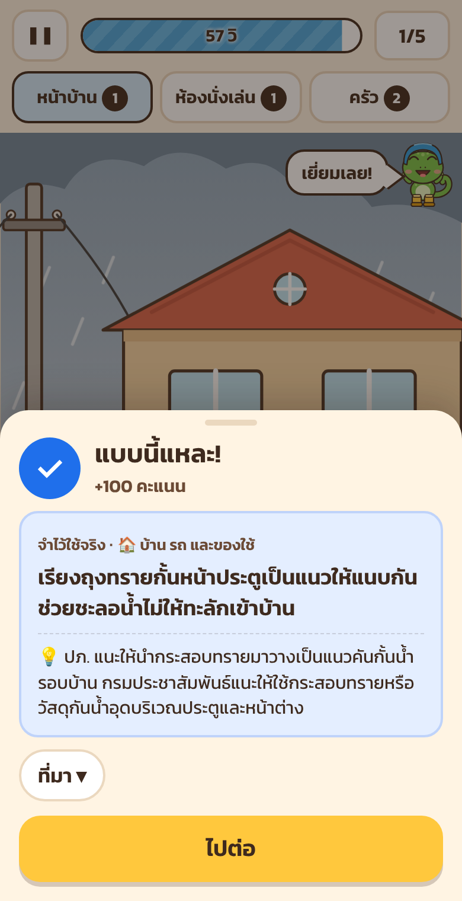
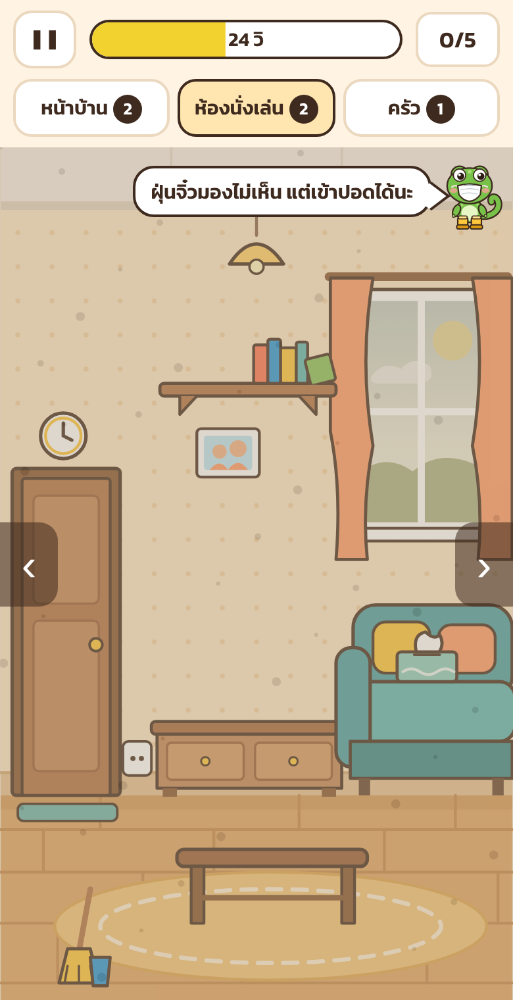
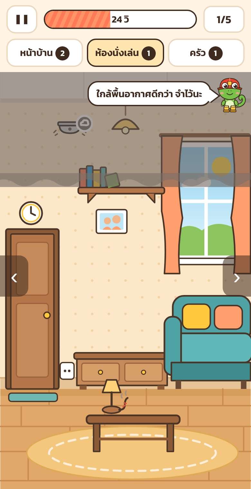
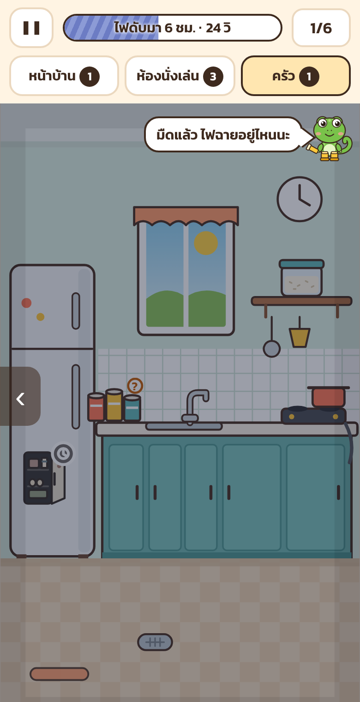
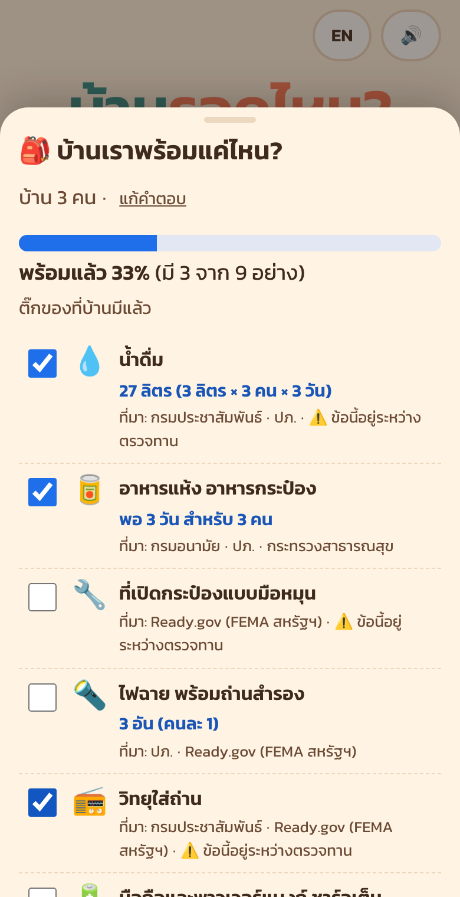
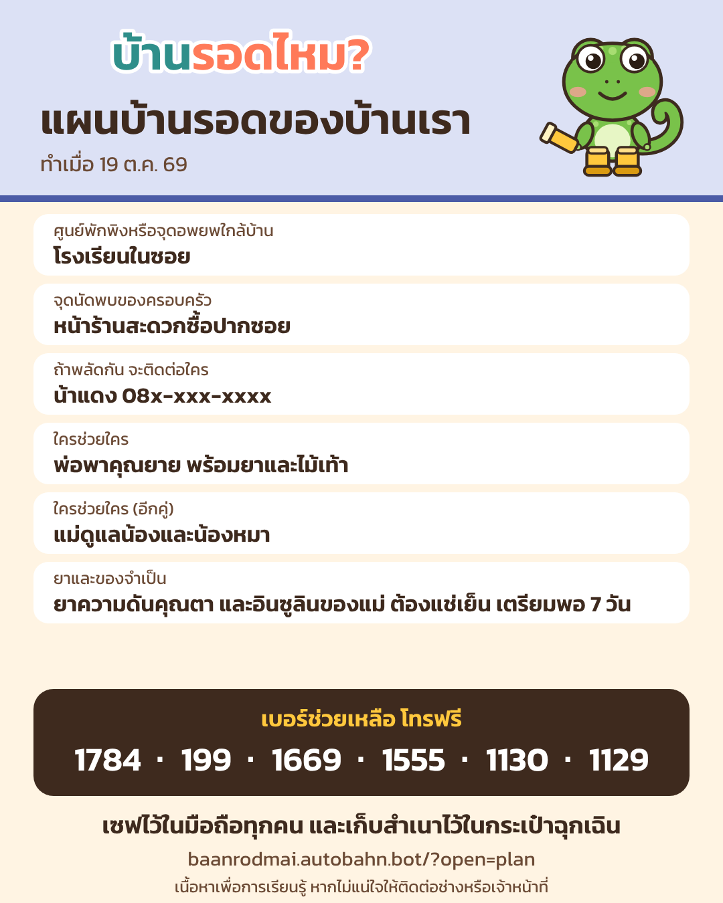
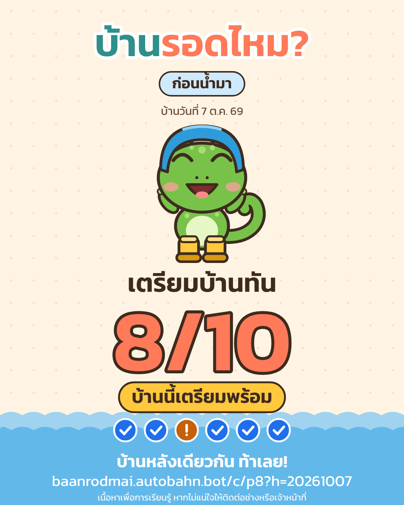
</p>

> **Status (21 Oct 2026): v1.13.1, live at [https://baanrodmai.autobahn.bot](https://baanrodmai.autobahn.bot), not yet launched.**
>
> - The code is finished and every automated check passes: 44 rule tests and 200 headless-browser checks, plus CI on every push. v1.9.0 made the app tools first, with a sourced guide for every hazard, four of them for hazards the game doesn't cover; v1.9.1 fixed what a second visitor audit of the live site found, and v1.9.2 what it left (wrong answers that gave the right one away, the back button inside a round, the result card at chat size) and added security headers. v1.10.0 added three calculators: the fridge in a power cut, dust today and the pills; v1.10.1 put them in plain words after the owner couldn't read the fridge tool. v1.11.0 made the fridge answer food by food, fixed a medicine line that could have made someone throw away insulin, and revised the whole app after a third visitor audit, read as an older relative in LINE, and research into who receives it ([docs/07-audience.md](docs/07-audience.md)). v1.11.1 stopped dust today from putting a mask on a baby; v1.12.0 added the mask tool and all the tools on one page with the agencies' own pages; v1.13.0 six more tools, and v1.13.1 fixed what a fourth visitor audit found in them.
> - **Thai and English**, each with its own pages, link previews and search signals ([international version](#thai-and-english)).
> - The water-level button opens **BKK FloodWatch** (`flood.autobahn.bot`), the owner's own Autobahn Bot project.
> - Before launch it still needs the owner to confirm Web Analytics (its beacon is on the live site), the sitemap (44 addresses) submitted to the search consoles, a review of 21 safety items flagged ⚠️ and a Thai review of the dust, fire and power-cut lessons, of the home check's ⚠️ lines, of the fridge tool's US hours and food lists, of its insulin, medicine and breast-milk lines (a pharmacist and a nurse, ideally), and of the four new guides (which rest on news reports quoting the agencies), a native-speaker language check (including the wrong answers rewritten in v1.9.2 and the calculators' texts, in plain words since v1.10.1), a doctor's and a pharmacist's read of the mask lines, heat today's first aid and the emergency card (v1.12.0–v1.13.0), and a pass on real phones (including the hub, print, the guides and the calculators inside LINE, since v1.11.0 "ก+" and the copy buttons there, and since v1.13.0 "I'm safe" by SMS).
> - **Proposed, not built (21 Oct 2026):** "around my home", today's situation and the place's own risks without the position leaving the phone; the open data was tested live ([docs/08](docs/08-open-data.md), [ROADMAP N28](docs/ROADMAP.md#n28-home-today-and-home-risk-proposed)). It waits for the owner's yes, two API keys and a licence. With a server of our own ([docs/09](docs/09-server.md), [N29](docs/ROADMAP.md#n29-a-server-that-publishes-files-proposed)), the server should publish files and know nobody; the law applies from the first per-person record.
> - Start with **[HANDOFF.md](HANDOFF.md)**.

## Highlights

- **Plain HTML, CSS and JavaScript with SVG art.** No framework and no build dependencies. It runs on the **free Cloudflare Pages plan**.
- **Thai and English.** Thai at `/`, English at `/en/`; the first visit picks Thai for Thai browsers or Bangkok time and English for everyone else.
- **Light:** 296 KB compressed to the start screen and 311 KB to the first game screen, counting the tools' code, which loads only when a tool opens, and the sources' notes, which the game doesn't show yet has to download (the limit is 500 KB).
- **Findable by search engines and AI assistants, in both languages.** The game draws itself with JavaScript, so the build also writes plain-HTML pages and files that crawlers can read ([details below](#seo-and-ai-search)).
- **Made to be shared and replayed (v1.3.0).** The result card prints the link to its own house, a friend's challenge can be answered with both scores, a safety book collects the playable lessons by topic (79 in 8 topics today), and a perfect 10 gets its own stamp.
- **Knowledge by topic (v1.4.0).** Every lesson has a topic: 🦠 health after floods, ⚡ power & gas, 💧 water & food, 🐍 snakes & sharp things, 🏠 home, 🎒 plans, and since v1.5.0 😷 dust and smoke and 🔥 fire safety. The topic in the news gets a card on the start screen, and `/learn#t-health` links straight to it.
- **A game for the whole year (v1.5.0).** Four modes on one mode registry: flood before and after, PM2.5 dust (a thickening haze, the Air4Thai colours, an Air4Thai link) and house fire (smoke falling from the ceiling, helpline 199), each with its own challenge links, previews and 10-item checklist.
- **Keeps itself current, links straight to a mode, a page per hazard (v1.6.0).** The owner's switches (the rain warning, the topic in the news) have end dates and turn themselves off, so the start screen can't stay on floods into the dust season. `/?mode=dust` opens the game on one mode for posts and campaigns. `/flood`, `/pm25` and `/fire` (and `/en/…`) each show one hazard's lessons, checklists and helplines, with a ▶ button into the game and a link preview of their own. The shared result card now carries the ending that answers "บ้านรอดไหม?".
- **A night without power (v1.7.0).** A fifth mode, ไฟดับ: the room darkens over 12 story hours, the clock shows the hours without power ("ไฟดับมา 4 ชม."), and the fridge's food goes bad at 4 hours if nobody deals with it (the US CDC's figure). 13 lessons on water, stock, the fridge and freezer, torches, not candles, a battery radio, power banks, unplugging and generators; a checklist "ไฟดับ 3 วัน บ้านเราพร้อม 10 ข้อ"; and the page `/ready`. It was prompted by a stockpiling infographic going round Thai social media, and teaches only what agencies back: 10 of its lessons rest partly or wholly on international guidance and are marked ⚠️ until a Thai review. Now 79 playable lessons in five modes and 8 topics.
- **How ready is our home? (v1.8.0).** Two answers (how many people; small children, older people, daily medicine, pets) give the household's own list: up to 15 things with amounts worked out for it (water 3 L × people × 3 days, a torch each, 7 days of daily medicine), each with its source and ⚠️ where it is still under review. Ticks fill a meter, and the result is a card to send to the family (the score, the things still missing, the link). A second card, **the family plan**, holds the shelter, the meeting place, who to contact and who helps whom, with the helplines, for every phone in the house; empty fields get a dotted line to fill in by hand (v1.8.1). Answers and text stay on the device; only anonymous counts are sent.
- **Checked as a visitor (v1.8.1).** Every screen, card and page was walked in Thai and English at 320 × 460 and 360 × 640. That found a tagline still naming three hazards, "flashlight" beside "torch" (the English is now British throughout), a card line that could start with "!", a wordmark running into the sun, and Thai words breaking at 320 px; all fixed. The flood pages and results now offer the home check and plan card too, and the installed app has shortcuts to both.
- **Tools first, a guide for every hazard (v1.9.0).** The start screen leads with what to do, what to keep and the family plan; the game sits below. Nine guides of 10 lines each: the five game checklists, and four new guides with no game, น้ำป่า ดินถล่ม, พายุ ลมแรง ฟ้าผ่า, แผ่นดินไหว and อากาศร้อนจัด, grouped by before, during and after, with a source on every line (35 ✅, 5 ⚠️, from 36 new sources, mostly Thai agencies as quoted in the news, cross-checked with Ready.gov, WHO, the US CDC and the US NWS). What the sources disagree on (unplugging in lightning, water amounts in the heat, when to leave a tall building) was left out. Each guide has a picture to forward, a page (`/quake`, `/heat`…), a print button for an A4 list, and a ready post on `/posts`; an owner-set alert puts one on top while it is in the news, and ends by itself. The home check and the plan card got pages with their own previews, `/kit` and `/plan`.
- **Checked as a visitor again (v1.9.1).** Three auditors walked the live site in parallel. Sharing to LINE no longer sends the game's tab away, the phone's back button closes a sheet instead of leaving the site, Thai words no longer break mid-word (a hand-kept list of words that stay together), the fire smoke shows on shorter phones, the hazard pages lead with the checklist and the free helplines, each tool has one name, unknown addresses get a real 404 page, and the flood gives a careful player time to read (the floor is wet at 36 s; nothing is under water before 20 s). The HUD counts only what the player did, and shows what the water took apart.
- **Answers you have to read (v1.9.2).** The right answer used to be the longest choice in most sets, so it could be guessed; 117 wrong answers now give the reason a real person would give for that mistake, and length tells nothing either way (a test keeps it so); the answers are lettered ก ข ค instead of an icon that often marked the right one. No advice changed. The phone's back button in a round pauses it instead of leaving the site, the shared result card can be read at the size a chat shows it, the guides with no game give the gecko a hard hat, a rain hood or a sun hat, and security headers stop other sites from framing the app.
- **Calculators (v1.10.0).** The owner liked that the home check "works out what to prepare and how much" and asked for more like it. **ไฟดับ: ของในตู้เย็นยังกินได้ไหม?** counts the hours of a power cut (since v1.10.1 from one tap, and it goes on after the app is closed) and says, part by part, whether the food still keeps and for how much longer: a closed fridge 4 h, a full freezer 48 h, a half-full one 24 h, cold medicine a day, from the US CDC and Ready.gov, flagged ⚠️ because no Thai agency gives them. **ฝุ่นวันนี้ บ้านเราต้องทำอะไร?** takes the colour an app shows, or a number, asking whether it is µg/m³ or Thailand's AQI (the same number is a different colour), and gives what everyone at home, young children, older people, pregnant women and people with a long-term illness should do, from the PCD's notice in the Royal Gazette (blue 0–15.0, green 15.1–25.0, yellow 25.1–37.5, orange 37.6–75.0, red 75.1+ µg/m³, the 24-hour average), with two DOH lines named. **ยาพอกี่วัน?** in the home check says how many days the pills last and how many more make 7. Each has a page (`/fridge`, `/air`), a tile on the start screen, a text to send to the family, and a build check that stops on any figure not in its source.
- **Calculators in plain words (v1.10.1).** The owner sent a screenshot of the fridge tool and wrote: "I cannot understand, please review and validate the UI and UX, try to improve and use general simple language." It had passed every check: right, but not clear. Now each tool asks one question at a time, by a tap (9 buttons for how long the power has been off; the five dust colours first, the number behind "รู้ตัวเลข?"), counts nothing until asked, answers with a word first ("ยังกินได้", "ใกล้ครบ 4 ชม.", "เกิน 4 ชม.แล้ว") and one line, and names its sources once. The dust advice is in everyday words with the notice's meaning and strength kept. No hour, band or source changed.
- **Food by food, and the whole app for its real readers (v1.11.0).** The owner asked for the fridge to work out how long each thing keeps, a usability revision of the whole app, and research into who receives it. **The fridge** now says what to throw out and what to keep: 13 kinds of food (meat and fish, ลูกชิ้น and sausages, leftovers, cooked rice and fresh noodles, eggs, milk and soy milk, made-up formula, cut fruit, cream cakes; whole fruit, bread, butter and hard cheese, soy sauce and jam) and 4 kinds of freezer pack, each from a row of FoodSafety.gov's or USDA FSIS's charts, with "anything not on the list: if in doubt, throw it out"; น้ำปลา is left out on purpose, because the US "fish sauces: discard" row doesn't fit a Thai cupboard. Insulin keeps 28 days at 15–30 °C (the US FDA), other cold medicine says "check the label, ask a pharmacist", and breast milk follows the CDC. **Dust today** always shows the advice for people at risk. **Every phone number says whom it reaches** ("1669 เจ็บป่วย", "1130 ไฟดับ กทม. นนทบุรี สมุทรปราการ"), and each guide shows the numbers that fit it. **Sharing says what it really sends,** with "copy as text" for the plan and the shopping list of what the home still needs. **"ก+"** makes the start screen and the sheets larger, a trust line says the app is free and asks for nothing, the alert says until when, and the Thai pages are Thai only. The research is [docs/07-audience.md](docs/07-audience.md): seven personas, from the morning forwarder to the grandparent who never taps a link.
- **Posts that teach on their own (v1.6.1).** Each hazard has a ready-made set of images for a Facebook album, an Instagram carousel or LINE (four sets since v1.7.0): a cover, one page per lesson with its source, the checklists and the game's address. Open [`/posts`](https://baanrodmai.autobahn.bot/posts) on a phone to save them in order and copy the Thai caption ([04-launch-kit](docs/04-launch-kit.md#posting-the-carousels-v161)).
- **Plays offline after the first visit,** thanks to a service worker.
- **Works inside the LINE, Facebook and TikTok in-app browsers.** Where an app blocks sharing or downloads, the game falls back to another way.
- **All content is editable JSON** in `public/content/`. The build checks it before anything is published.
- **No personal data and no cookies.** Only anonymous event counts are collected. What a family answers or types in the home check, the plan card and the calculators never leaves the phone; "copy as text" (v1.11.0) puts it on the phone's clipboard only.
- **Accessible:**
  - every tap target and button is at least 44 px on phones 360 px wide or wider
  - highlights are colour-blind safe (blue / orange / grey, plus shapes)
  - nothing flashes
  - it respects reduced-motion settings

## Quick start

```bash
node tools/build.mjs                    # validate content, generate preview pages and the service worker
npx wrangler@latest pages dev public    # http://localhost:8788
npm test                                # game-rule tests (no browser)
npm install && npm run smoke            # browser checks (needs Chromium; set CHROME_PATH if needed)
npm run check:docs                      # after editing docs: every relative link and anchor resolves
```

Node 18 or later is required. Cloudflare builds with Node 22, pinned in `.node-version`. Browser checks use `playwright-core` 1.63.0. Install its browser with `npx playwright@1.63.0 install chromium`, or point `CHROME_PATH` at any recent Chromium.

## Thai and English

| | Thai | English |
|---|---|---|
| The game | `/` | `/en/` |
| Every lesson, with sources | `/learn` | `/en/learn` |
| A friend's challenge link | `/c/p8?h=…` | `/en/c/p8?h=…` |
| What to do: the guide picker (v1.9.0) | `/?open=guide` | `/en/?open=guide` |
| One guide, as a picture to forward | `/checklist/prepare`, `/checklist/quake` (any of nine, v1.9.0) | `/en/checklist/prepare`, `/en/checklist/quake` |
| One hazard's lessons (v1.6.0) | `/flood`, `/pm25`, `/fire`, `/ready` (v1.7.0) | `/en/flood`, `/en/pm25`, `/en/fire`, `/en/ready` |
| One hazard's guide, no game (v1.9.0) | `/landslide`, `/storm`, `/quake`, `/heat` | `/en/landslide`, `/en/storm`, `/en/quake`, `/en/heat` |
| The home check and the plan card (v1.9.0 pages) | `/kit`, `/plan` | `/en/kit`, `/en/plan` |
| The calculators (v1.10.0) | `/fridge`, `/air` (or `/?open=fridge`, `/?open=air`) | `/en/fridge`, `/en/air` |
| Masks and all tools (v1.12.0) | `/mask`, `/tools` | `/en/mask`, `/en/tools` |
| Six more tools (v1.13.0) | `/hot`, `/water`, `/tank`, `/info`, `/safe`, `/bag` | `/en/hot` … `/en/bag` |
| Open the game on one mode (v1.6.0) | `/?mode=dust`, `/?mode=stock` | `/en/?mode=dust` |
| Wordmark | บ้านรอดไหม? | Baan Rod Mai? |

- **Which language a visitor gets:** `?lang=`, then an `/en` address, then their earlier choice (only one they made with the language button or `?lang=`, since v1.9.1), then a first-visit guess (Thai for Thai browsers **or** Bangkok time, English otherwise). The address bar follows the language, and English players share `/en/` links.
- **Search and social:** each page and its other-language twin point to each other with `hreflang`; the sitemap lists both; each language has its own link previews (`public/og/` and `public/og/en/`) and its own structured data.
- **Honest scope outside Thailand:** most advice comes from Thai agencies, some from international guidance (marked), and the helplines are Thai numbers; the English pages say so. Details: [KNOWLEDGE §18](docs/KNOWLEDGE.md#18-international-version-and-social-previews).

## SEO and AI search

Most AI crawlers and link-preview bots don't run JavaScript, so a game that renders in the browser looks empty to them. `node tools/build.mjs` therefore also writes, from the same JSON the game uses:

| Output | For |
|---|---|
| [`/learn`](https://baanrodmai.autobahn.bot/learn) and [`/en/learn`](https://baanrodmai.autobahn.bot/en/learn) | Every lesson (correct action, tip, reason, sources, ⚠️ where partly verified), every guide (since v1.9.0, with the sources under the new guides' lines), links to the home check and plan card (v1.8.1) and the helplines: Thai with English, and English-first. Plain HTML, no script. |
| [`/flood`](https://baanrodmai.autobahn.bot/flood), [`/pm25`](https://baanrodmai.autobahn.bot/pm25), [`/fire`](https://baanrodmai.autobahn.bot/fire), [`/ready`](https://baanrodmai.autobahn.bot/ready) (v1.7.0) and their `/en/` twins (v1.6.0) | One hazard each: since v1.9.1 its checklists first, under the free helplines, then ▶ buttons that open the game on that mode and every lesson with its sources; `/flood` and `/ready` also link the home check and plan card. Plain HTML, no script. The addresses come from `config.json → hazards` and never change once published. |
| [`/landslide`](https://baanrodmai.autobahn.bot/landslide), [`/storm`](https://baanrodmai.autobahn.bot/storm), [`/quake`](https://baanrodmai.autobahn.bot/quake), [`/heat`](https://baanrodmai.autobahn.bot/heat) and their `/en/` twins (v1.9.0) | A hazard with no game: a jump to each phase and the free helplines, then its guide by phase, with every line's sources, then the picture link, the home check and plan card and the helplines. |
| [`/kit`](https://baanrodmai.autobahn.bot/kit), [`/plan`](https://baanrodmai.autobahn.bot/plan) and their `/en/` twins (v1.9.0) | The home check's and the plan card's lines with their sources, a button into the tool, and a link preview of their own. |
| [`/mask`](https://baanrodmai.autobahn.bot/mask), [`/tools`](https://baanrodmai.autobahn.bot/tools) (v1.12.0) and [`/hot`](https://baanrodmai.autobahn.bot/hot), [`/water`](https://baanrodmai.autobahn.bot/water), [`/tank`](https://baanrodmai.autobahn.bot/tank), [`/info`](https://baanrodmai.autobahn.bot/info), [`/safe`](https://baanrodmai.autobahn.bot/safe), [`/bag`](https://baanrodmai.autobahn.bot/bag) (v1.13.0), with their `/en/` twins | Each tool's lines with their sources, a button into the tool and a preview of its own; `/tools` also lists the agencies' pages and the emergency-alert steps. |
| [`/fridge`](https://baanrodmai.autobahn.bot/fridge), [`/air`](https://baanrodmai.autobahn.bot/air) and their `/en/` twins (v1.10.0) | The calculators' figures with their sources (the fridge's hours and, since v1.11.0, its food lists, medicine and breast milk; the five dust colours with both bands and the lines for everyone, people at risk and a long-term illness), a button into the tool, and a link preview of their own. |
| `/llms.txt` | A Markdown summary for AI assistants ([llmstxt.org](https://llmstxt.org)), listing both languages, the hazard pages, (v1.8.1) the family tools, since v1.10.0 all four with their pages, and (v1.9.0) each new guide's lines with their source URLs |
| `/sitemap.xml`, `/robots.txt` | Crawler discovery (44 addresses since v1.13.0), with `hreflang` pairs. Search and AI crawlers are welcome; only `/api/` is closed. |
| `<link rel="canonical">`, `hreflang` and JSON-LD | `WebSite`, the publisher (`Organization`, v1.9.2) and the app (`VideoGame` + `WebApplication`, `UtilitiesApplication`) on `/` and `/en/`, and `Article` with source citations, `author` and `publisher` on `/learn`, the hazard pages and their English twins. The challenge pages point their canonical at `/` (Thai) or `/en/` (English); since v1.9.1 the checklist pages point theirs at the hazard's page. |
| `X-Robots-Tag: noindex` on `*.pages.dev` | Only the custom domain is indexed |
| `/404.html` (v1.9.1) | Unknown addresses get a small Thai and English "not found" page with status 404 and `noindex`, instead of the start screen |

The Thai and English copy for these pages is in `public/content/strings.json → seo` (and `ogEn` for English link previews). Bump `seo.updated` when lessons change. The rules and the reasons are in [APPROACH_AND_METHOD §13](docs/APPROACH_AND_METHOD.md#13-making-the-game-findable-seo-and-ai-search).

## Deploy (Cloudflare Pages, about 5 minutes)

The live site was set up this way on 6 Oct 2026: project `baanrodmai`, address https://baanrodmai.autobahn.bot. The setup is recorded in [docs/03-deploy.md](docs/03-deploy.md#the-live-setup). To repeat it elsewhere, connect this repository under **Workers & Pages → Create → Pages → Connect to Git** and use these settings:

| Setting | Value |
|---|---|
| Framework preset | None |
| Root directory | *(leave empty: the repository root)* |
| Build command | `node tools/build.mjs` |
| Build output directory | `public` |
| Site address | `config.json → siteUrl`. Because `wrangler.toml` manages the project, a dashboard `SITE_URL` is cleared on the next build. |

You also need **Analytics Engine** enabled once on the Cloudflare account (Workers → Analytics Engine → create the dataset `baanrodmai_events` with binding `EVENTS`). Without it the deploy fails at the Functions step. The full steps are in [docs/03-deploy.md](docs/03-deploy.md). They cover Wrangler direct upload, Web Analytics, the Analytics Engine binding, "Fail open", and baking your domain into the images.

## Documents

**Start here**

| Document | What's inside |
|---|---|
| [HANDOFF.md](HANDOFF.md) | Current state, what the owner must decide before launch, how to run and operate it, and next steps |
| [docs/ROADMAP.md](docs/ROADMAP.md) | What to do next: launch tasks and v1.1+ work as task cards with steps and "done when" |
| [AGENTS.md](AGENTS.md) | For AI assistants: read order, commands, definition of done, how the owner works, sandbox notes. Claude Code loads it through [CLAUDE.md](CLAUDE.md). |
| [CHANGELOG.md](CHANGELOG.md) | What changed, release by release |

**Project deliverables**

| # | Document | What's inside |
|---|---|---|
| 1 | [Safety content table](docs/01-safety-content.md) | 81 items in five modes, each with the wrong action, the correct action, a Thai tip (≤ 80 characters) and its official source. Anything not fully verified is flagged. The counts at the top are generated from the content. |
| 2 | [Game design and wireframes](docs/02-game-design.md) | The tools-first start screen and the guides, rules, the five modes, the home check and plan card, the calculators (v1.10.0; the fridge food by food since v1.11.0), scoring, mascot, sharing, accessibility, the version 2 structure, and a code map |
| 3 | [Deploy to Cloudflare Pages](docs/03-deploy.md) | The live setup, Git and Wrangler steps, the free-plan budget, search setup, and why link previews are pre-rendered |
| 4 | [Launch kit](docs/04-launch-kit.md) | Thai post copy (Facebook, LINE, TikTok), the 5-minute playbook for when something is in the news, outreach, the Prepare → Return switch, and the seasonal relaunch |
| 5 | [Metrics plan](docs/05-metrics.md) | Event dictionary and Analytics Engine SQL for every metric |
| 6 | [Test checklist](docs/06-test-checklist.md) | Automated tests, plus a real-phone matrix (75 checks across 8 browser and app combinations) and the live-site checks |
| 7 | [Who receives it](docs/07-audience.md) (v1.11.0) | Thai audiences on LINE and social media: platform reach, older adults, how disaster information spreads, devices, who is most at risk, seven personas, the sharer and the receiver, what to change and what to watch, with 50 sources |
| 8 | [Open data for "around my home"](docs/08-open-data.md) (research, 21 Oct 2026) | How the owner's FloodWatch reads open APIs and what carries over; 30+ Thai and global sources tried live (warnings, dust, heat, rain, rivers, flash floods, earthquakes, fire hotspots, faults, landslides, flood history) with auth, CORS, licence and result; how the position stays on the phone; pitfalls; what needs the owner; a phased proposal ([ROADMAP N28](docs/ROADMAP.md#n28-home-today-and-home-risk-proposed)). Nothing built yet |
| 9 | [With a server of our own](docs/09-server.md) (research, 21 Oct 2026) | What a server unlocks and what it must not do: measured costs of 13 sources (bytes, CPU, freshness), TMD's warning polygons against 7,425 subdistricts, Air4Thai's certificate chain and its fix, where to host (FloodWatch's server, Workers Paid, Bangkok), Web Push and LINE OA, the PDPA and the traffic-data rule, the sources' terms; one recommended path ([ROADMAP N29](docs/ROADMAP.md#n29-a-server-that-publishes-files-proposed)). Nothing built yet |
| — | [Research records](docs/research/) | The full records behind docs 08 and 09: [every open-data call](docs/research/open-data-2026-10-21.md) (113, with URL, status, size and CORS) and [the server research](docs/research/server-2026-10-21.md) (every quote and measurement) |

**Reference for maintainers**

| Document | What's inside |
|---|---|
| [Knowledge base](docs/KNOWLEDGE.md) | Every rule, constant and formula; the content model; platform limits; audience research with sources |
| [Known issues](docs/KNOWN_ISSUES.md) | Open issues, platform limits and deliberate trade-offs, with measurements |
| [Guidelines](docs/GUIDELINES.md) | Rules for editing safety content, writing Thai and English copy, changing code, testing and releasing |
| [Approach and method](docs/APPROACH_AND_METHOD.md) | How the project was researched, designed, built, verified, optimized, made international and kept honest |
| [Lessons learned](docs/LESSONS_LEARNED.md) | What went wrong or right while building it, and the rule each lesson became |
| [UI/UX Review & Optimization](review/README.md) | Live evaluation, 3-loop refinement cycle (9.74/10 optimal), persona validation, and [iteration log](review/ITERATION_LOG.md) |

## แก้เนื้อหาเอง (สำหรับทีมที่ไม่ได้เขียนโค้ด)

ทุกอย่างที่ผู้เล่นเห็นอยู่ในโฟลเดอร์ `public/content/` (มีทั้งภาษาไทยและอังกฤษ ต้องแก้ให้ตรงกันทั้งสองภาษา) แก้บน GitHub ได้เลย (กดรูปดินสอ → Commit) ระบบจะตรวจไฟล์ให้ก่อนขึ้นเว็บ ถ้ามีอะไรผิด เว็บเดิมจะยังอยู่ ไม่พัง

| อยากแก้อะไร | ไฟล์ | ระวัง |
|---|---|---|
| เปลี่ยนโหมดที่แนะนำ (ฝนกำลังมา / น้ำลดแล้ว) | `config.json` → `"rainWarningActive": true` หรือ `false` | เปิดเมื่อไร ใส่วันสิ้นสุดด้วยทุกครั้ง เช่น `"rainWarningUntil": "2026-11-30"` (ปี ค.ศ.-เดือน-วัน เวลาไทย นับวันนั้นด้วย หลังจากนั้นปิดเอง) |
| หมวดที่กำลังเป็นข่าวบนหน้าแรก | `config.json` → `featuredTopic` (`null` = ไม่มี) | ใส่วันสิ้นสุด `featuredTopicUntil` ด้วยทุกครั้ง |
| การ์ด "ช่วงนี้" บนหน้าแรก เมื่อมีข่าวภัยไหน (v1.9.0) | `config.json` → `"alert": { "guide": "quake", "until": "2026-11-02" }` | `guide` ต้องเป็นชื่อใน `guides` · ต้องมีวันสิ้นสุดเสมอ (ไม่มี = ไม่ขึ้น) · หมดวันแล้วตั้งกลับเป็น `null` ไม่งั้นระบบจะเตือนทุกครั้ง ดูขั้นตอนใน [docs/04-launch-kit.md](docs/04-launch-kit.md#when-something-happens-the-5-minute-playbook) |
| ลิงก์แอปเช็กระดับน้ำ / โดเมน | `config.json` → `forecastAppUrl`, `siteUrl` | ต้องขึ้นต้นด้วย `https://` |
| คำแนะนำ ตัวเลือก เคล็ดลับ คำอธิบาย "ทำไม?" | `items.json` | `tip` ไม่เกิน 80 ตัวอักษร · ต้องมีคำตอบถูก (`"correct": true`) ข้อเดียว |
| ที่มาของข้อมูล | `sources.json` | รหัสต้องตรงกับที่ใช้ใน `items.json` |
| ข้อความปุ่ม คำพูดน้องจก ฉายา ข้อความแชร์ | `strings.json` | อย่าลบ `{คำในวงเล็บปีกกา}` · แก้ทั้ง `th` และ `en` · ข้อความตัวอย่างลิงก์ภาษาอังกฤษอยู่ที่ `ogEn` |
| เช็กลิสต์ 10 ข้อ และคู่มือ "ต้องทำอะไร" | `checklists.json` (ลำดับและไอคอนอยู่ที่ `config.json` → `guides`) | ต้องมี 10 ข้อพอดี · คู่มือที่ไม่มีเกม (น้ำป่า พายุ แผ่นดินไหว อากาศร้อน) ทุกข้อต้องมี `phase` `sources` และ `verify` · อีโมจิใช้แบบเก่า (Unicode 11) · ถ้าแก้แล้ว รันภาพใหม่ด้วย `npm run images` |
| "เช็กของจำเป็น" และการ์ดแผนครอบครัว | `kit.json` | ทุกข้อต้องมีที่มาใน `sources.json` · ตัวเลขในจำนวนที่คำนวณ (เช่น 3 ลิตร 3 วัน) ต้องมีอยู่ในชื่อหรือบันทึกของแหล่งที่มา · แก้ทั้ง `th` และ `en` |
| "ไฟดับ: ตู้เย็น" และ "ฝุ่นวันนี้" (v1.10.0) | `kit.json` → `fridge`, `air` | ชั่วโมงของตู้เย็นและตัวเลขช่วงสีฝุ่นทุกตัวต้องมีอยู่ในชื่อหรือบันทึกของแหล่งที่มา (ระบบตรวจให้) · ทุกบรรทัดต้องมีที่มา · บรรทัดของกรมอนามัยต้องบอกชื่อหน่วยงานไว้ · แก้ทั้ง `th` และ `en` |
| เครื่องมืออื่น: หน้ากาก ร้อนวันนี้ น้ำพอกี่วัน ล้างถัง บัตรข้อมูลฉุกเฉิน ส่งข่าวว่าปลอดภัย กระเป๋าฉุกเฉิน (v1.12.0–v1.13.0) | `kit.json` → `mask`, `hot`, `water`, `tank`, `info`, `safe`, `bag`; รายชื่อและลำดับเครื่องมือ `config.json` → `tools`; ช่องตามฤดูบนหน้าแรก `config.json` → `hub` | ตัวเลขทุกตัวต้องอยู่ในที่มา (build ตรวจ) · ข้อที่มีแต่หน่วยงานต่างประเทศบอก ใส่ ⚠️ |
| ลิงก์หน่วยงาน (v1.12.0) | `kit.json` → `links` | ลิงก์ไปหน้าที่ใช้งานจริง ไม่ใช่หน้าแรก · ใส่วันที่ตรวจ (`checked`) · รัน `npm run links` เดือนละครั้ง |
| เบอร์ช่วยเหลือ | `helplines.json` | ตรวจเบอร์กับหน่วยงานก่อนทุกครั้ง |
| คำไทยถูกตัดขึ้นบรรทัดใหม่กลางคำ (เช่น "กระ\|จก") | `config.json` → `keepTogether` | ใส่ทั้งคำ ภาษาไทยล้วน 2–14 ตัวอักษร · ห้ามใส่ตัวอักษรที่มองไม่เห็นลงในข้อความ · ถ้าคำนั้นอยู่ในรูป ให้รันภาพใหม่ |
| เปิดห้องใหม่ | `rooms.json` → `"enabled": true` | ต้องมีภาพห้องใน `public/art/rooms/` ก่อน |
| ชื่อหน้าของแต่ละภัย (/flood /pm25 /fire /ready /landslide /storm /quake /heat) | `config.json` → `hazards` | ห้ามเปลี่ยนหลังเปิดตัว เพราะลิงก์ที่แชร์ไปแล้วจะเสีย |

ถ้าแก้คำแนะนำด้านความปลอดภัย ให้ใส่แหล่งที่มาใน `sources.json` ทุกครั้ง และโพสต์บอกผู้เล่นด้วยคำว่า **"UPDATE:"** อย่าแก้เงียบๆ (ดูกติกาเต็มใน [docs/GUIDELINES.md](docs/GUIDELINES.md))

## Project structure

```
public/            static site (Cloudflare Pages output directory)
  content/         ← editable JSON (items, rooms, strings, config, sources, checklists, helplines, kit, carousel)
  js/              game modules (plain ES modules, no bundler)
  art/             room SVGs + sprite sheet
  fonts/           Kanit Thai/Latin subsets (SIL OFL, see fonts/OFL-Kanit.txt)
  og/ og/en/ share/ pre-rendered link previews (Thai, English), checklists, sample cards
  c/ checklist/    generated link-preview pages (Thai)
  flood.html pm25.html fire.html ready.html   generated hazard pages (Thai)
  landslide.html storm.html quake.html heat.html kit.html plan.html   generated guide and tool pages (Thai, v1.9.0)
  fridge.html air.html   generated calculator pages (Thai, v1.10.0)
  mask.html tools.html hot.html water.html tank.html info.html safe.html bag.html   generated tool pages (Thai, v1.12.0–v1.13.0)
  404.html         generated "not found" page (Thai + English, v1.9.1)
  en/              generated English app shell, lessons, hazard and link-preview pages
functions/api/e.js anonymous event counter → Workers Analytics Engine
tools/             build.mjs (validate + generate), render-images.mjs, sw.template.js, probe.mjs, check-docs.mjs, links.mjs (v1.12.0)
tests/             run.mjs (rules), smoke.mjs (headless browser)
docs/              everything above + screens/
AGENTS.md CLAUDE.md  guidance for AI assistants
```

## History

The game was first built on a feature branch of `bejranonda/carrier-vector-1988`, in its `baanrodmai/` folder. On 6 Oct 2026 it moved here, to the repository root, with its first two commits kept. That branch was never merged, and it has since been reset to `master`, so `carrier-vector-1988` holds only the flight sim again.

## Credits and license

- **Game, illustrations and the mascot น้องจก:** original work for this project. **License:** MIT, see [LICENSE](LICENSE).
- **Font:** [Kanit](https://github.com/cadsondemak/kanit) by Cadson Demak, SIL Open Font License 1.1 ([public/fonts/OFL-Kanit.txt](public/fonts/OFL-Kanit.txt)).
- **Safety guidance:** Thai government agencies, and for a few lessons international agencies (WHO, the US Fire Administration, the US CDC, Ready.gov, the Tokyo Metropolitan Government, the US National Weather Service), cited item by item in [docs/01-safety-content.md](docs/01-safety-content.md) and, for the four guides with no game, line by line in [KNOWLEDGE §29.3](docs/KNOWLEDGE.md#293-the-four-new-guides-and-their-sources), and for the calculators in [KNOWLEDGE §32](docs/KNOWLEDGE.md#32-calculators-the-fridge-dust-today-the-pills-v1100) (the PCD's AQI notice in the Royal Gazette, the US CDC and Ready.gov). The guidance itself belongs to those agencies; the game only links to and summarises it.

*เนื้อหาเพื่อการเรียนรู้ หากไม่แน่ใจให้ติดต่อช่างหรือเจ้าหน้าที่*
